# Code Classroom 🚀
> **Self-Hosted Automated Programming Assessment System**

A modern web platform built for computer laboratory classes to schedule, run, and automatically evaluate programming assessments in real time over a Local Area Network (LAN).

Developed as an undergraduate capstone project at **Palompon Institute of Technology (PIT)**.

---

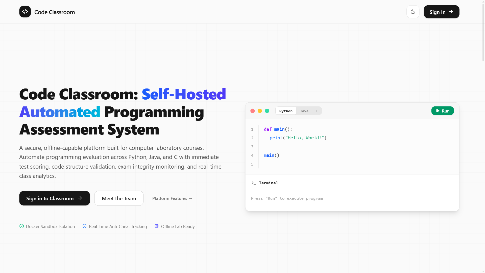

---

## 💡 Overview

In traditional programming laboratory classes, evaluating student code manually takes a significant amount of time, and running exams in unmonitored environments makes assessment integrity difficult to track.

**Code Classroom** addresses this by providing an offline-capable, browser-based assessment platform. Students write and execute code in an embedded editor, while their solutions are automatically evaluated inside isolated Docker containers against dynamic test cases and Abstract Syntax Tree (AST) structure rules.

---

## 🛠️ Tech Stack

| Component | Technology |
| :--- | :--- |
| **Frontend** | React, Vite, Tailwind CSS, Monaco Editor, Socket.io Client |
| **Backend** | Node.js, Express, Socket.io |
| **Execution Sandbox** | Docker (Ephemeral Alpine Linux containers) |
| **Database** | PostgreSQL 16 |
| **AI Integration** | Google Gemini API *(Used exclusively for problem drafting)* |
| **Deployment** | Self-hosted on Local Area Network (LAN) |

---

## 🏗️ System Architecture

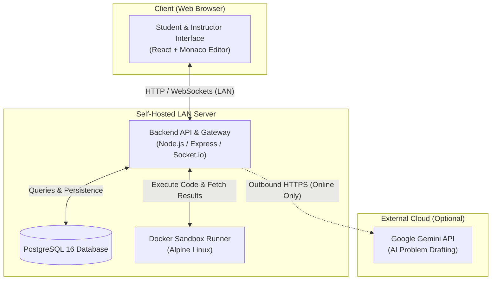

> **Offline-First Design**: The core platform (taking assessments, code execution, grading, and telemetry) runs completely offline within a local campus network without requiring internet connectivity.

---

## 📸 Platform Walkthrough

### 1. Student Experience

#### 💻 In-Browser IDE & Real-Time Test Runner
Students take assessments through an integrated Monaco Code Editor supporting **Python**, **Java**, and **C**. They can run code against visible sample cases, review terminal output, and verify locked test cases upon submission.

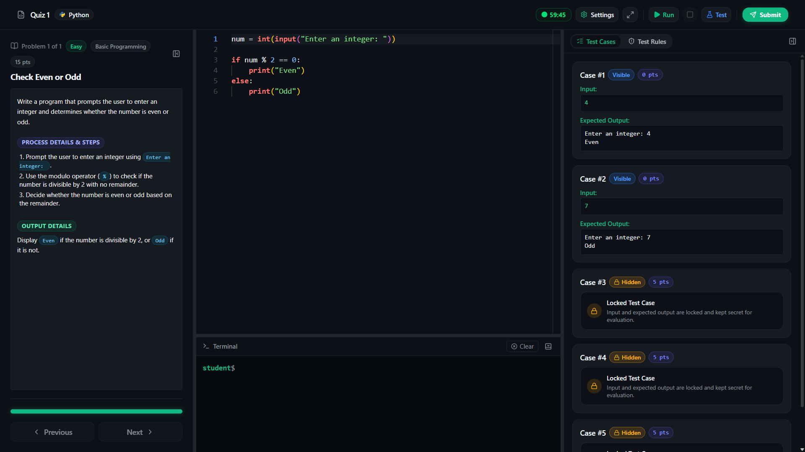

#### 🧪 Instant Pass/Fail Feedback
Submissions are evaluated on the fly. Students receive clear pass/fail breakdowns and score updates right inside the assessment environment.

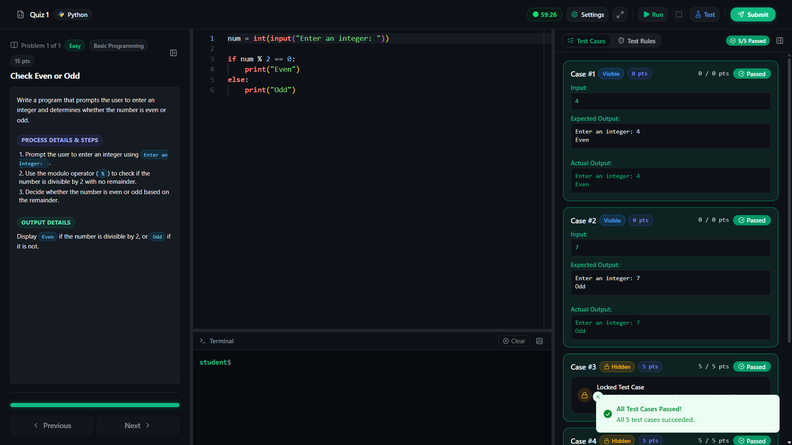

#### 📊 Post-Assessment Results & Feedback
Upon submission, students can review their overall score, completion time, and submit quick difficulty ratings.

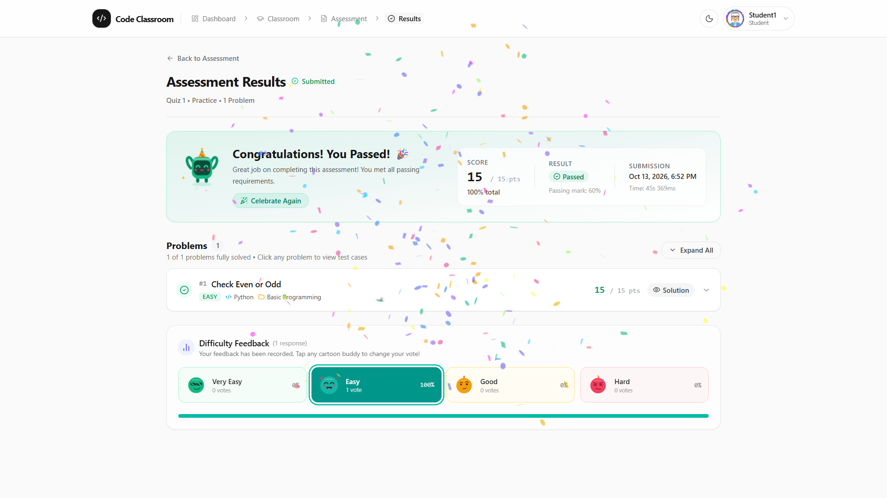

#### 🎨 Playground & Avatar Customization
Outside of exams, students can practice code freely in an open playground and customize their profile avatars.

| Code Playground | Avatar Customization |
| :---: | :---: |
| 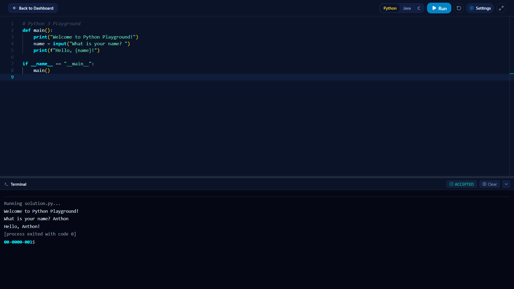 | 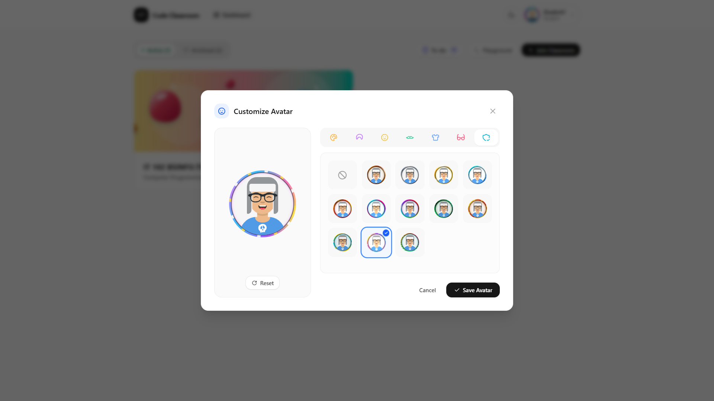 |

---

### 2. Instructor Experience

#### 📋 Dashboard & Classroom Management
Instructors can manage multiple classrooms, generate unique student **Join Codes**, and schedule upcoming coding tests.

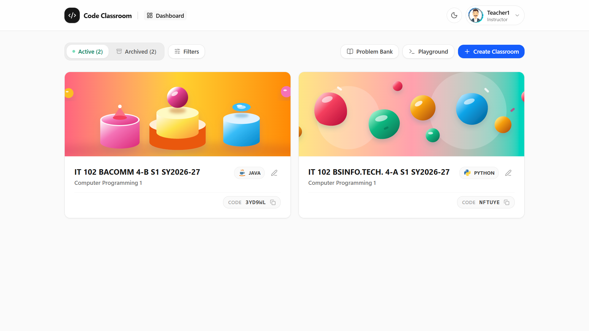

#### 📝 Problem Authoring & Solution Verification
Instructors can author programming challenges, configure visible and hidden test cases, set AST constraints, and verify reference solutions directly in the built-in sandbox before assigning them.

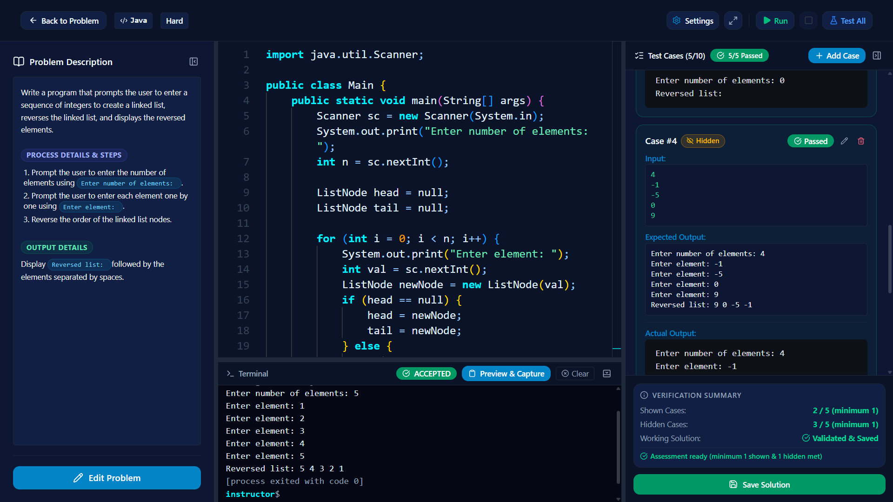

#### 🤖 AI-Assisted Problem Generation
Integrated with the Google Gemini API to quickly generate programming prompts, sample test cases, and starter code templates.

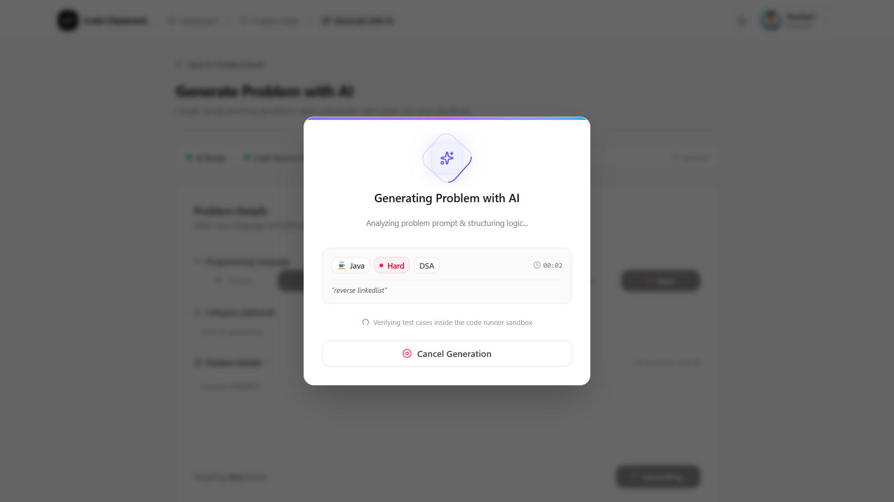

#### 📈 Class Analytics & Item Analysis
Instructors can inspect question difficulty, class pass rates, and identify specific test cases where students struggled most.

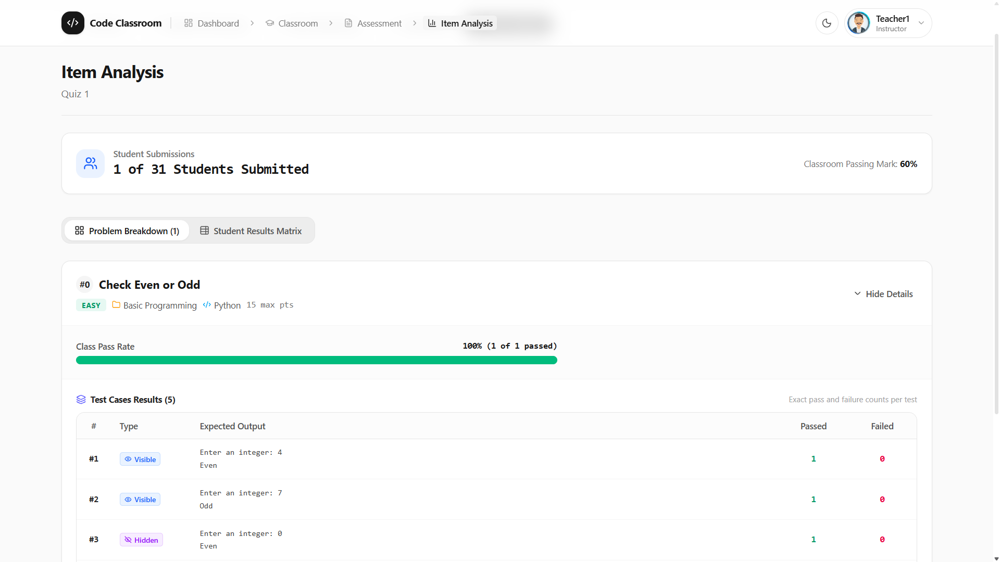

---

## ⚡ Key Engineering Highlights

1. **Safe Code Execution**: Runs student code inside isolated Docker containers with memory and time limits to stop infinite loops and keep the server safe.
2. **Dual-Layer Grading**: Tests both program output (correct answer) and code structure (like requiring loops, conditions, using AST analysis).
3. **Live Exam Activity Monitoring**: Tracks tab switches and paste actions in real time using Socket.io so teachers can check exam integrity.
4. **Offline LAN Support**: Runs directly over the school local network (LAN), so students can take exams even without internet access.

---

## 👥 Project Team

Developed as an academic capstone project by:

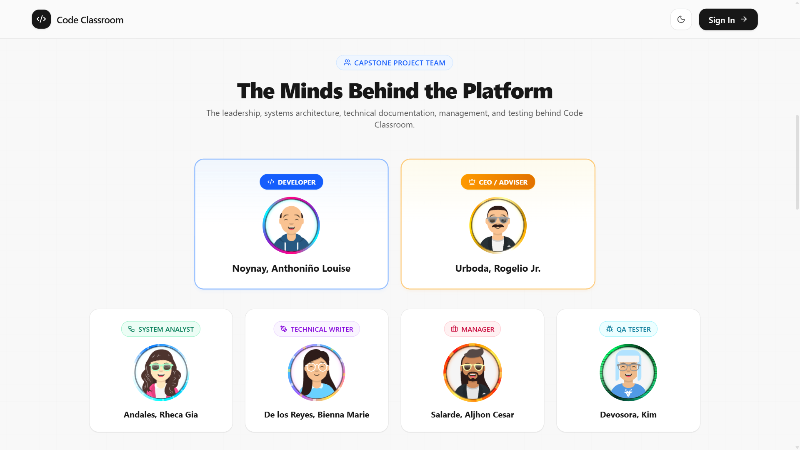

- **Anthoniño Louise Noynay** — Developer
- **Rogelio Urboda Jr.** — CEO / Adviser
- **Rheca Gia Andales** — System Analyst
- **Bienna Marie De los Reyes** — Technical Writer
- **Aljhon Cesar Salarde** — Manager
- **Kim Devosora** — QA Tester

---

## 🔒 Source Code & Demo Availability

> **Notice**: This repository serves as a project portfolio and overview. The source code and runner configurations are currently kept **private** in accordance with institutional guidelines.

### 🎥 Live Walkthrough
If you are an employer, recruiter, or reviewer interested in seeing the system in action:
- **Live Demo**: Available on request via **Google Meet** or **Zoom**.

---

## 📬 Contact

- **Email**: anthonlouisenoynay123@gmail.com
- **Facebook**: https://www.facebook.com/profile.php?id=61585875337215
- **GitHub**: https://github.com/anthon-louise
